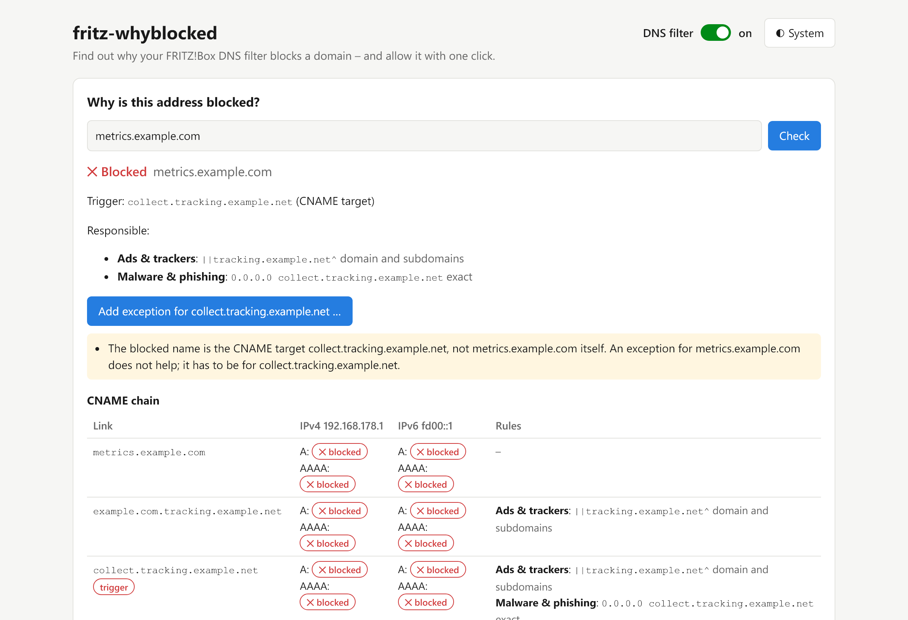
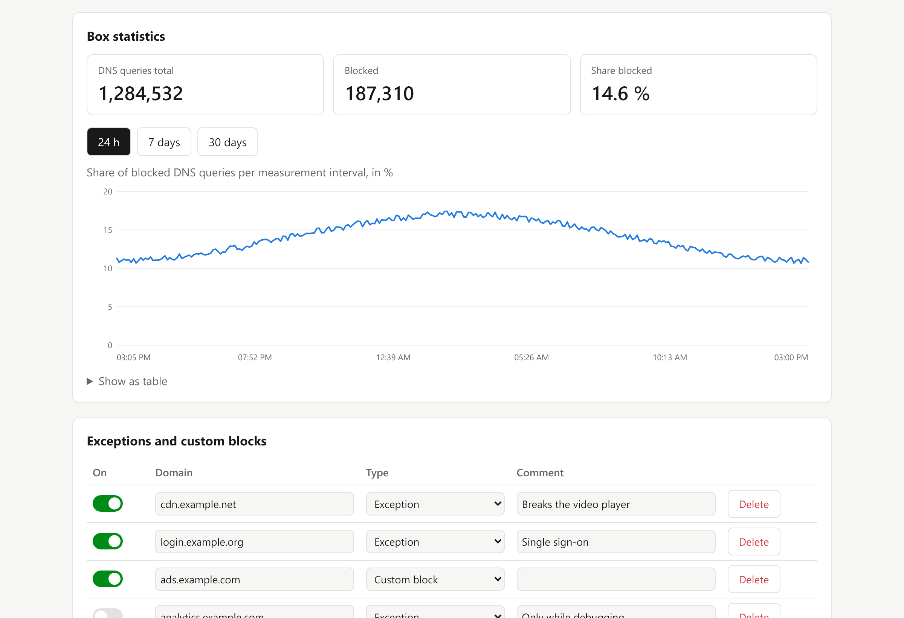
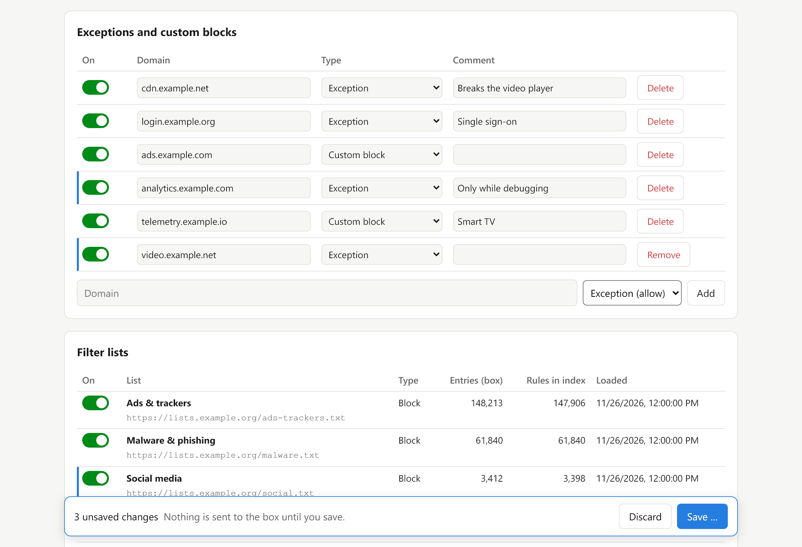
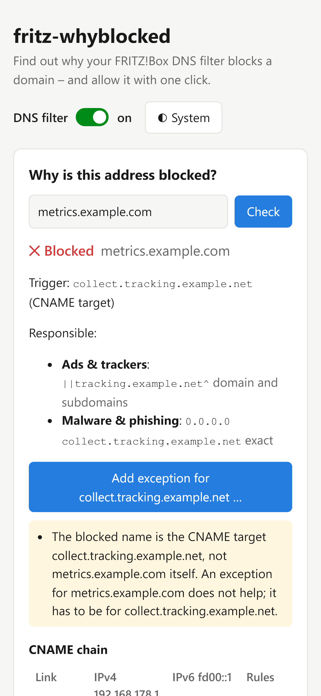
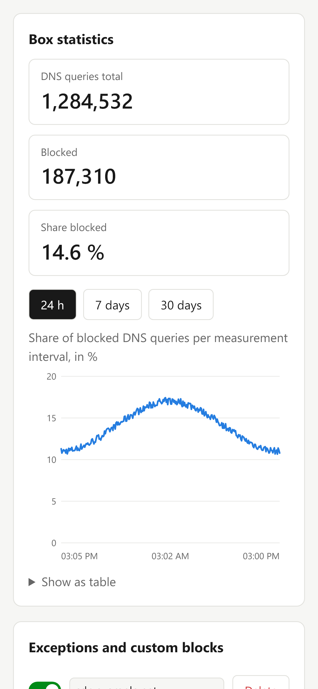
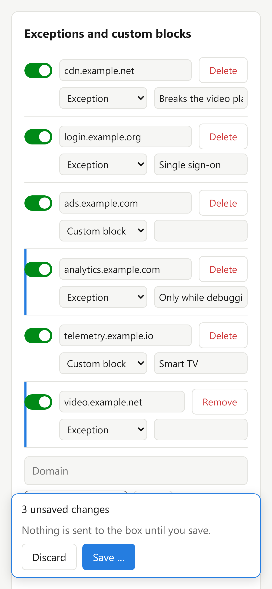

# fritz-whyblocked

_Find out why your FRITZ!Box DNS filter blocks a domain – and allow it with one click._

Enter a domain or URL. fritz-whyblocked shows whether the FRITZ!Box DNS filter blocks it, which link of the CNAME chain triggers the block, and which filter list is responsible. You can add an exception with one click. You can also add, edit and delete exceptions and custom blocks, and switch the filter lists and the whole filter. These changes are collected on the page and saved together. It also shows the box's statistics.

> Not an official product of FRITZ! GmbH; not affiliated with it.

<picture>
  <source media="(prefers-color-scheme: dark)" srcset="docs/screenshots/check-dark.png">
  
</picture>

## A look around

The box's own statistics are sampled every few minutes, so the share of blocked queries can be followed over a day, a week or a month.

<picture>
  <source media="(prefers-color-scheme: dark)" srcset="docs/screenshots/statistics-dark.png">
  
</picture>

Exceptions, custom blocks and filter lists are edited in place. Nothing reaches the box until you save, and then only after a dry run lists the requests.

<picture>
  <source media="(prefers-color-scheme: dark)" srcset="docs/screenshots/filter-dark.png">
  
</picture>

On a phone, the tables turn into one card per entry or list.

<table>
  <tr>
    <td width="33%">
      <picture>
        <source media="(prefers-color-scheme: dark)" srcset="docs/screenshots/mobile-check-dark.png">
        
      </picture>
    </td>
    <td width="33%">
      <picture>
        <source media="(prefers-color-scheme: dark)" srcset="docs/screenshots/mobile-statistics-dark.png">
        
      </picture>
    </td>
    <td width="33%">
      <picture>
        <source media="(prefers-color-scheme: dark)" srcset="docs/screenshots/mobile-filter-dark.png">
        
      </picture>
    </td>
  </tr>
</table>

The screenshots show made-up data: `bun run screenshots` serves the UI with a fixed set of example domains, lists and statistics and never talks to a box.

## How the analysis works

1. The CNAME chain is resolved via a reference DNS (default `1.1.1.1`).
2. Each link is queried directly at the box (A and AAAA, via IPv4 and optionally IPv6). The tool recognizes a block by the answer `0.0.0.0` or `::`.
3. The last blocked link is the **trigger**. Often that is a CNAME target: an exception for the requested name does not help then; it has to be for the target.
4. Rules are looked up in the rule index for each link and its parent domains. Hits are confirmed against the cached list text and shown with the original line.

The rule index stores a 44-bit hash plus the rule kind per rule in a sorted `Float64Array`, i.e. 8 bytes per rule. There is no packet capture and no DNS proxy, so the tool does not slow down the network.

Changes to the box always follow the same steps. First a dry run shows the requests that will be sent. Then they are sent, and the tool reads the state again to check that the change arrived.

## Requirements

- FRITZ!Box with DNS filter and the beta API `/api/v0/beta/dnsfilter` (tested with 7590, FRITZ!OS 8.50)
- [Bun](https://bun.sh), version in `.bun-version`; no other runtime dependencies

> The API is `beta` and may change with FRITZ!OS updates.

## Running locally

```sh
cp .env.example .env   # set FRITZ_PASSWORD
bun install            # dev tooling only; there are no runtime dependencies
bun start              # http://127.0.0.1:8053 (bun run start:dev restarts on changes)
```

Without `UI_PASSWORD` the UI only listens on `127.0.0.1`. With it set, the UI is reachable from the LAN via basic auth. Write requests need the header `X-WhyBlocked: 1` (CSRF protection). `GET /api/health` answers without auth.

## Development

```sh
bun test --parallel    # tests sit beside the module they exercise (src/*.test.ts)
bun run typecheck
bun run lint           # oxlint, type-aware (.oxlintrc.json)
bun run fmt            # bun fmt; fmt:check only checks
bun run build          # dist/fritz-whyblocked.js, one file with the UI embedded
```

CI (`.github/workflows/ci.yml`) runs all of these on every pull request and push, and deploys pushes to `main`; see [docs/deployment.md](docs/deployment.md).

How the code is organized, the conventions it follows (pinned dependencies, Renovate) and what a change touches are in [docs/architecture.md](docs/architecture.md), [docs/coding-guidelines.md](docs/coding-guidelines.md) and [docs/checklists.md](docs/checklists.md); [AGENTS.md](AGENTS.md) indexes them.

## Configuration

| Variable              | Default               | Meaning                                                     |
| --------------------- | --------------------- | ----------------------------------------------------------- |
| `FRITZ_HOST`          | `fritz.box`           | Address of the box                                          |
| `FRITZ_USER`          | empty                 | User; empty = most recently used user from `login_sid.lua`  |
| `FRITZ_PASSWORD`      | –                     | Password (or systemd credential `fritz-password`)           |
| `BOX_DNS_V4`          | resolved `FRITZ_HOST` | DNS address of the box for probing                          |
| `BOX_DNS_V6`          | empty                 | IPv6 address of the box (e.g. ULA); empty = no IPv6 probe   |
| `REFERENCE_DNS`       | `1.1.1.1`             | Resolver for the CNAME chain                                |
| `PORT`                | `8053`                | Port of the UI                                              |
| `UI_PASSWORD`         | empty                 | UI password (or credential `ui-password`)                   |
| `DATA_DIR`            | `./data`              | List cache and statistics (under systemd: `StateDirectory`) |
| `STATS_INTERVAL`      | `300`                 | Statistics polling in seconds                               |
| `LISTS_REFRESH_HOURS` | `24`                  | Filter list refresh in hours                                |

## Deployment

Pushes to `main` deploy through a self-hosted GitHub Actions runner to a Fedora server, where the app runs as a systemd user service. [docs/deployment.md](docs/deployment.md) covers the pipeline, the server setup and operating it.

## Open points

- Does an exception for a parent domain also allow its subdomains? Does the box interpret Adblock, hosts and domain entries the same way for subdomains? Until that is clear, the UI marks such hits as "interpretation unclear".
- Whether `statistics.dnsQueryCount` counts continuously or per day; the history treats a falling counter as a reset.
- Capture on demand (later; slows the box down to 60–100 Mbit/s while recording).

## License

[MIT](LICENSE)
